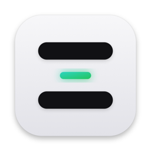
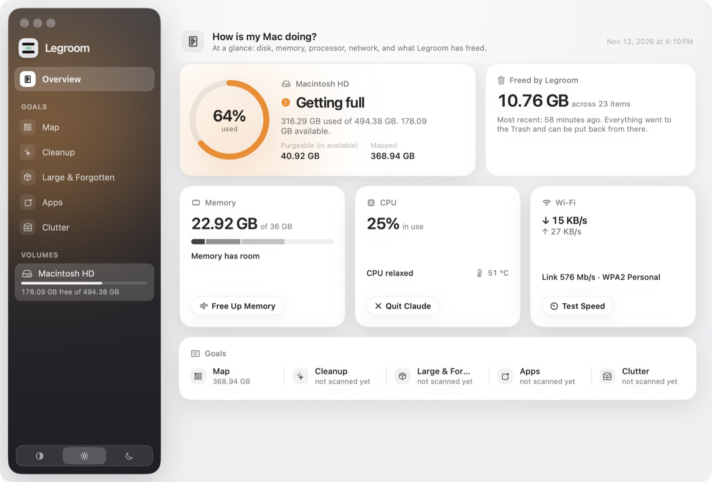
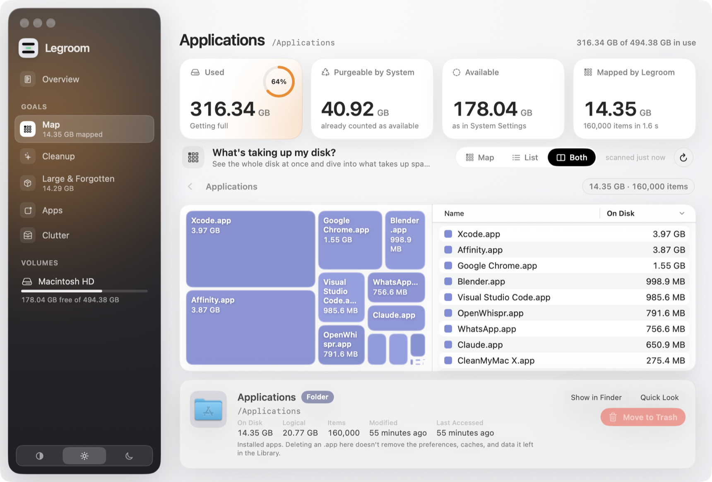
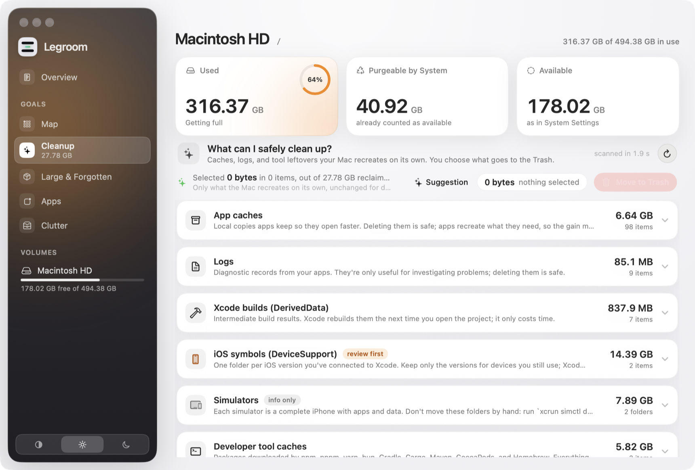

<p align="center">
  
</p>

<h1 align="center">Legroom</h1>

<p align="center">
  A free, open-source storage manager for macOS.<br>
  See where your disk space went, clean up what you don't need, and uninstall apps completely — with everything going to the Trash, never deleted for good.
</p>

<p align="center">
  <a href="../../releases/latest"><b>Download the latest release</b></a> ·
  macOS 14 Sonoma or later · Apple silicon and Intel · English and Brazilian Portuguese
</p>

<p align="center">
  
</p>

## Why

Most Mac "cleaners" are subscriptions wrapped in scare tactics: red warnings, a "junk" score, a big button that deletes things you never looked at. Legroom is the opposite:

- **Nothing runs on its own.** Every scan starts when you ask for it. The main scan even needs a press-and-hold.
- **Nothing is deleted permanently.** Every removal goes to the Trash, so you can put it back. Legroom never empties the Trash.
- **Everything is explained.** Each item shows its full path, size on disk, logical size, dates and, for well-known folders, what it is and whether it's safe to remove.
- **No accounts, no telemetry, no subscription.** The only network request is the optional speed test, and only when you click it.

## Features

| | |
|---|---|
| **Overview** | Disk health at a glance, memory, CPU (with chip, battery and SSD temperatures), network, and how much Legroom has freed so far. |
| **Map** | A full scan of a volume or folder as a treemap plus a sortable list. The last scan is saved and reopens instantly, and it also fills in the other tabs. |
| **Cleanup** | Caches, logs, Xcode DerivedData and archives, iOS device support, iPhone backups, Mail downloads and developer tool caches. The rules are plain JSON ([`cleanup-rules.json`](Lupa/Resources/cleanup-rules.json)), each with an explanation. A conservative selection is pre-checked: only safe groups, only items untouched for days, never caches of apps that are open. |
| **Large & Forgotten** | Files and packages over 50 MB, filterable by size, age and type. |
| **Apps** | Every app with its real size, version and last opened date. **Uninstall** finds what the app left behind — app support data, containers, caches, preferences, logs, launch agents, hidden folders in your home, even the installer DMG in Downloads — and lets you review it before anything moves. |
| **Clutter** | Duplicates confirmed by content (SHA-256), downloads you haven't opened in 90 days, leftover installers and screenshots. |
| **Menu bar & widgets** | A compact Overview in the menu bar, and Desktop / Notification Center widgets in three sizes. |

<p align="center">
  
</p>
<p align="center">
  
</p>

## Install

1. Download `Legroom-<version>.dmg` from [Releases](../../releases/latest). It's signed with a Developer ID and notarized by Apple.
2. Drag Legroom to Applications and open it.
3. Optional but recommended: give Legroom **Full Disk Access** in System Settings › Privacy & Security › Full Disk Access. Without it, macOS hides some folders (Mail, Messages, some app containers) and the scan will be incomplete. Legroom tells you when that happens.

Legroom is distributed outside the Mac App Store on purpose: the App Store requires the sandbox, which would make a full disk scan, the process list and complete uninstalls impossible.

## How it works

- **Scanning.** The disk is walked with `fts(3)` (`FTS_PHYSICAL | FTS_NOCHDIR`), the same way `du` does it. Sizes are **allocated** sizes (`st_blocks × 512`), which is what you actually get back when a file is removed; the logical size (`st_size`) is shown alongside, so sparse files, compression and APFS clones are visible. Hard links count once. A full scan of a 500 GB disk with ~3 million files takes about 2–3 minutes.
- **Saved map.** The last full scan is stored as a compact pre-order binary tree (varints, LZFSE-compressed; ~35 MB for 4 million nodes) in `~/Library/Application Support/Legroom/maps`. Reopening it doesn't touch the disk; items you send to the Trash afterwards are recorded and removed from the saved tree.
- **Uninstall.** Leftovers are matched by the app's bundle identifier (and those of the helpers, extensions and XPC services inside it) and by the app's exact name — never by substring, so uninstalling "Nod" finds `~/.nod-desktop` but not `chronod`. Names and identifiers belonging to other installed apps are excluded, and hidden folders that only match by name are left unchecked, since they're often command-line tools with the same name. Items owned by the system (apps installed by a `.pkg`) are moved by Finder, which asks for your administrator password in its own dialog; Legroom never sees it.
- **Temperatures** are read from the sensors macOS publishes through IOHID (the same approach as tools like [Stats](https://github.com/exelban/stats)). There's no public API for this, so the functions are resolved at runtime; if they're unavailable, the temperature simply isn't shown.
- **Memory** uses `host_statistics64`; **CPU** uses `host_cpu_load_info`; **network** uses `getifaddrs`. Readings run only while the Overview or the menu bar panel is visible.

## Build from source

Requirements: Xcode 16 or later and [XcodeGen](https://github.com/yonaskolb/XcodeGen) (`brew install xcodegen`). The Xcode project is generated from [`project.yml`](project.yml); edit that, not the `.xcodeproj`.

```bash
git clone https://github.com/rafabittt/legroom.git
cd legroom
LEGROOM_ADHOC=1 tools/build.sh      # Debug build, signed ad hoc, in build.noindex/
open build.noindex/Build/Products/Debug/Legroom.app
```

Or run `xcodegen generate` and open `Legroom.xcodeproj` in Xcode (set your own team under Signing & Capabilities).

With ad hoc signing the app works fully; only the widget can't read the shared App Group, so it shows disk, memory and CPU but not "freed" totals. `tools/install.sh` builds Release and installs into `/Applications`, and `tools/release.sh` produces a notarized DMG (it needs a Developer ID certificate and notarization credentials; see the comments at the top of the script).

### Project layout

```
Lupa/                  The app (the folder kept the project's working name)
  App/                 Entry point, AppState (state, navigation, actions), App Intents, debug launch flags
  Models/              Volumes, file tree, goals, cleanup rules, clutter, app leftovers, saved map,
                       memory / CPU / network / temperature readings, formatting
  Scanner/             FTSScanner: background fts(3) walk with progress and cancellation
  Views/               SwiftUI views: Overview, Map (treemap + list), goal screens, sidebar, menu bar, uninstall sheet
  Resources/           Localizable.xcstrings (pt-BR), cleanup-rules.json, App Shortcuts strings
LegroomWidget/         WidgetKit extension (sandboxed; reads shared totals through an App Group)
tools/                 build, install, release and widget snapshot scripts
```

## Translations

English is the development language. Brazilian Portuguese lives in [`Lupa/Resources/Localizable.xcstrings`](Lupa/Resources/Localizable.xcstrings) (and [`LegroomWidget/Localizable.xcstrings`](LegroomWidget/Localizable.xcstrings)). To add a language, open the String Catalogs in Xcode and add a localization — contributions are very welcome.

## Contributing

Issues and pull requests are welcome. A few principles the app sticks to, so PRs fit in:

1. Nothing scans or removes anything without the user asking.
2. Removals go to the Trash. No permanent deletion, no emptying the Trash.
3. Calm, plain language. No fear, no "threats", no fake urgency.
4. One process, no privileged helper, no login items.

## License

[MIT](LICENSE) © 2026 Rafael Bittencourt
